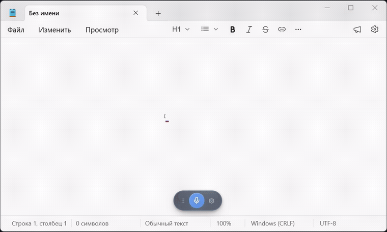
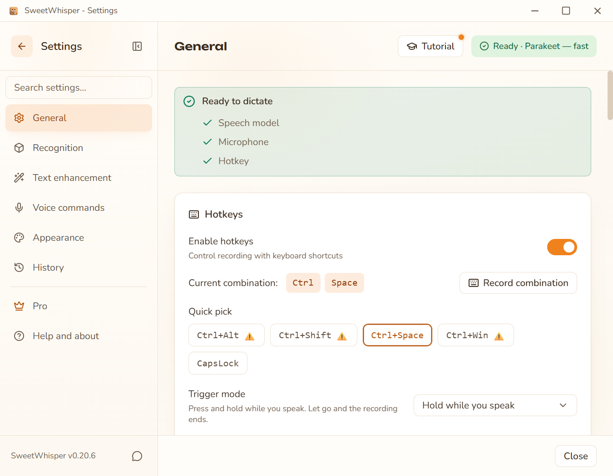
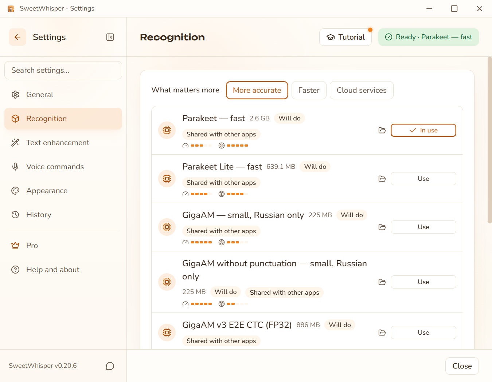
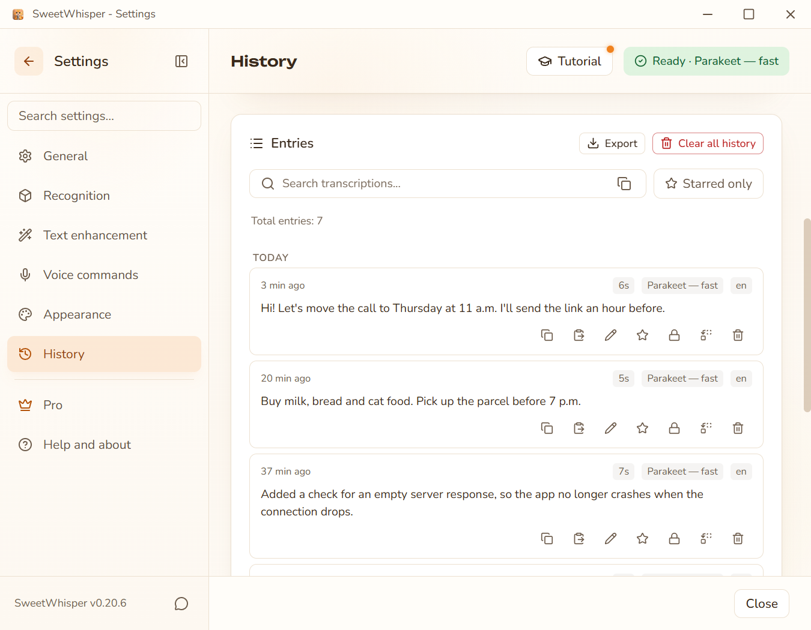
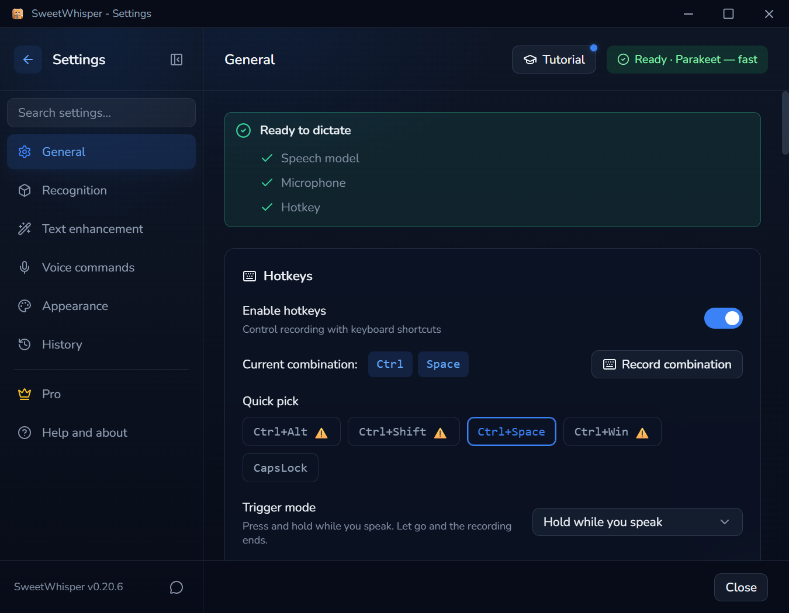
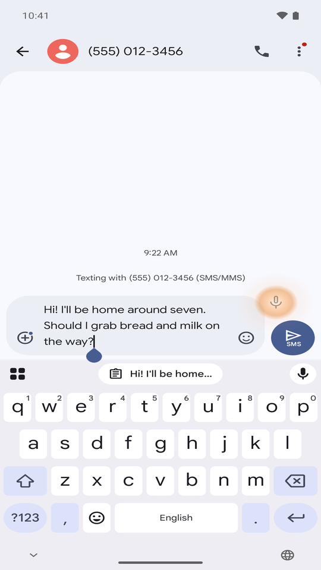
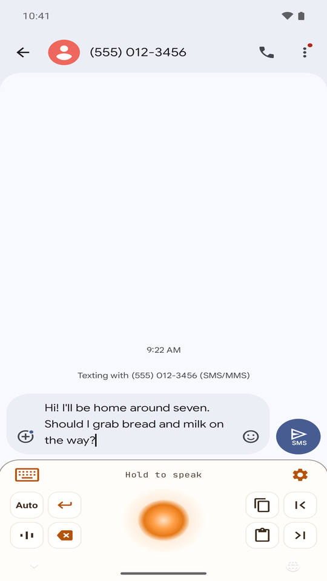
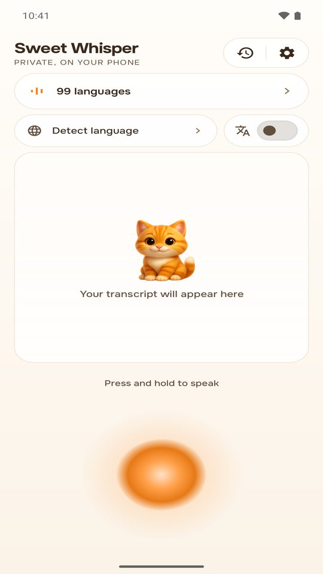
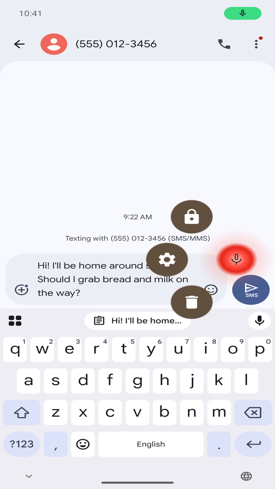

[Русский](README.md) · **English**

# SweetWhisper

### Speak — the text appears wherever your cursor is

**Voice typing for Windows and Android. Speech is recognized right on your device: no internet, no subscription, your voice never leaves it.**

<!-- Badge versions are edited by hand on each release. -->

[🌐 Website](https://sweetwhisper.app/en/) · [📱 Android](https://sweetwhisper.app/en/android/) · [❓ FAQ](#faq) · [📝 Changelog](https://sweetwhisper.app/en/changelog/) · [🐛 Report a bug](../../issues/new/choose)

---

## How it works

| 1. Hold a key | 2. Speak | 3. Release |
|:---:|:---:|:---:|
| One key for everything. On the phone, it's the mic on your keyboard | The model listens and recognizes your speech right on the computer or phone | The finished text is inserted into the active window: chat, email, document, code editor |

No copying, no switching windows, no voice sent to the cloud.

## Why SweetWhisper

- 🌍 **90+ languages.** Whisper and NVIDIA Parakeet cover English and many more; GigaAM is trained specifically on Russian.
- 🔒 **Your voice stays with you.** Recognition runs on your GPU or CPU. No accounts, no telemetry — it works even on a plane.
- ⌨️ **Works in any app.** Slack, browser, Word, your IDE — the text lands where the cursor blinks.
- 💸 **Dictation is free forever.** No per-minute limits, no subscription. Pro is a one-time purchase for those who want more.
- 🐱 **Pleasant to use.** A tidy always-on-top bar, light, cream and dark themes, hints at every step.

## Windows

<table>
<tr>
<td width="50%"> <b>See at a glance that you're ready</b> — model, microphone and hotkey</td>
<td width="50%"> <b>A model that fits your PC</b> — more accurate or faster, the app suggests one</td>
</tr>
<tr>
<td width="50%"> <b>Searchable history</b> — everything you dictated stays on your machine</td>
<td width="50%"> <b>Three themes</b> — light, cream and dark</td>
</tr>
</table>

- 🎙️ **Dictate into any window** — hold a key or toggle recording on and off
- 🧠 **Three engines to choose from** — Whisper, Parakeet and GigaAM; GPU acceleration on NVIDIA, AMD and Intel
- 🗣️ **Voice commands** — "Kitty, undo", "Kitty, open notepad"
- 📖 **Your own dictionary** — names and terms the model should spell right
- 📜 **History** — search everything you dictated, export, favorites
- ✨ **With Pro:** text appears while you are still speaking, a local AI drops filler words, fixes punctuation and translates, audio and video transcription with subtitles

## Android

It's a voice keyboard: you dictate right where you normally type. Open a chat, tap the mic, speak — the words land straight in the message.

- Dictation from the keyboard is free, with no limits
- Everything runs on the phone: audio is not saved and never leaves it
- 99 languages; GigaAM adds commas and capitals to Russian by itself
- The model is matched to your phone on first launch
- Floating button over any field, quick-settings tile, widget
- No ads, no account, no trackers

[How to install it and enable the keyboard, step by step →](https://sweetwhisper.app/en/android/)

## How it compares

| | **SweetWhisper** | Cloud services | Open-source tools | Windows dictation (Win+H) |
|---|:---:|:---:|:---:|:---:|
| Works offline | ✅ | ❌ | ✅ | ❌ for many languages |
| Audio stays on your computer | ✅ | ❌ | ✅ | ❌ |
| Choice of speech model | ✅ Whisper, Parakeet, GigaAM | ❌ their own | usually Whisper only | ❌ |
| Voice commands | ✅ | ❌ | ❌ | ❌ |
| AI text cleanup | ✅ Pro, on-device | ✅ in the cloud | ❌ | ❌ |
| Works out of the box | ✅ | ✅ | ❌ | ✅ |
| Price | free, Pro is one-time | subscription | free | free |

## Download

| Platform | File | Size | From the site | From GitHub |
|---|---|---|---|---|
| **Windows 10/11** · installer | `SweetWhisper-Setup.exe` | 21.0 MB | [download](https://sweetwhisper.app/dl/SweetWhisper-Setup.exe) | [v0.20.6](../../releases/tag/v0.20.6) |
| **Windows 10/11** · portable | `SweetWhisper-Portable.zip` | 39.9 MB | [download](https://sweetwhisper.app/dl/SweetWhisper-Portable.zip) | [v0.20.6](../../releases/tag/v0.20.6) |
| **Android 9+** · APK | `SweetWhisper.apk` | 36.7 MB | [download](https://sweetwhisper.app/dl/SweetWhisper.apk) | [android-v3.50](../../releases/tag/android-v3.50) |

The site and Releases serve the very same file, byte for byte. The site links always point at the newest build, while [Releases](../../releases) keep older versions and checksums. No sign-up needed.

## Free and Pro

| | Free | Pro |
|---|:---:|:---:|
| Unlimited dictation, every model, GPU acceleration | ✅ | ✅ |
| Searchable history, voice commands | ✅ | ✅ |
| Your own voice commands on the computer | up to 5 | up to 200 |
| Replacement dictionary on the computer (unlimited on the phone) | up to 20 | unlimited |
| Text appears while you speak | — | ✅ |
| Local AI: cleanup, punctuation, "email", "document", "code" modes | — | ✅ |
| Translation while dictating | — | ✅ |
| Audio and video transcription, SRT/VTT subtitles, speaker labels | — | ✅ |
| Floating dictation button on Android | — | ✅ |

**Pro is a one-time purchase, not a subscription.** One key unlocks Pro on both the computer and the phone. Try it free first: 14 days on the computer, the first 200 floating-button dictations on the phone. No card, no sign-up. [Price and what's included →](https://sweetwhisper.app/en/buy/)

## System requirements

**Windows**
- Windows 10 or 11, 64-bit
- 4 GB of RAM or more — enough for GigaAM, Parakeet Lite and Whisper Large V3 Turbo
- A GPU is optional. With one it is faster and live preview is available: NVIDIA, AMD or Intel with at least 1 GB of dedicated video memory
- 75 MB to 3 GB of disk space for models — you only download the ones you pick

**Android**
- Android 9 or newer
- 41 to 874 MB for the model — the app suggests a suitable one

## FAQ

<b>Windows says "Unknown publisher". Is it safe?</b>

Yes. That's SmartScreen: Windows shows it for files that few people have downloaded yet. Reputation builds up with the number of installs and starts from zero for every new version — it's a warning about newness, not about malware. Click "More info" → "Run anyway".

Don't want to take our word for it? Check the checksum: run `Get-FileHash SweetWhisper-Setup.exe` in PowerShell and compare the SHA-256 with the one on the [release page](../../releases/latest).

<b>Does it really work offline?</b>

Yes. You need the internet once — to download a model. After that, recognition runs entirely on the device, even on a plane. Cloud services (OpenAI, Yandex SpeechKit) can be added with your own key, but by default everything is offline.

<b>Where do my recordings go?</b>

Nowhere. Audio is processed on your computer or phone, and history lives in a local database you can clear at any time. No accounts, ads or telemetry. The app goes online to download the model you picked and to check for updates; an error report is sent only if you turned that on yourself. The full list is in the [privacy policy](https://sweetwhisper.app/en/privacy/).

<b>Does Pro send my text to the cloud?</b>

No, unless you switch that on yourself. By default the AI in Pro runs locally and the text never leaves your computer — fine for confidential documents too. Cloud models are only connected manually, with your own key.

<b>How is it better than built-in Windows or Google dictation?</b>

Windows dictation sends your voice to Microsoft's cloud. Google voice typing usually recognizes on Google's servers too. SweetWhisper recognizes on the device, lets you choose the model, understands voice commands and shows no ads.

<b>Is it safe to install the APK outside a store?</b>

Yes. The file is signed with our key: updates install on top, and nobody can swap the app for someone else's build. Android will ask once whether you trust the source — the usual step for apps from outside a store. Only take the APK from sweetwhisper.app or from Releases here.

<b>What about Linux or macOS?</b>

A Linux version is in the works, and the basics already run. macOS is not supported yet.

More answers in the [full FAQ](https://sweetwhisper.app/en/faq/).

## Found a bug? Have an idea?

Open an [issue](../../issues/new/choose) — the template will tell you what to attach. The app has a "Copy diagnostics" button (Settings → "Help and about"): paste its output into your report and the fix will come noticeably sooner. Fixes ship in days, not months.

Questions, impressions and wishes go to [Discussions](../../discussions).

## License

SweetWhisper is proprietary software (© Roger, all rights reserved). This repository holds distribution materials, not the source code.

The app is built on open engines — [whisper.cpp](https://github.com/ggml-org/whisper.cpp), [ONNX Runtime](https://github.com/microsoft/onnxruntime) — and open models: Whisper © OpenAI (MIT), GigaAM © SberDevices (MIT), Parakeet © NVIDIA (CC-BY-4.0), Silero VAD. The Android app is a fork of [whisperIME](https://github.com/woheller69/whisperIME) © woheller69 (MIT). Full list in the app: Settings → About → "Open source licenses".
