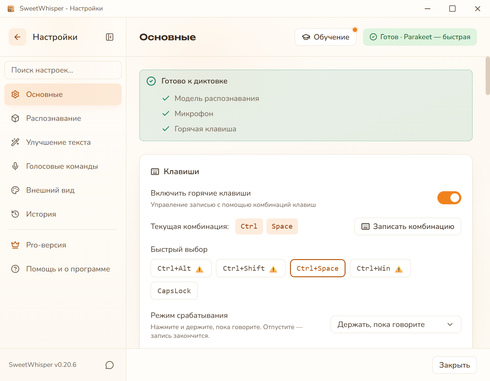
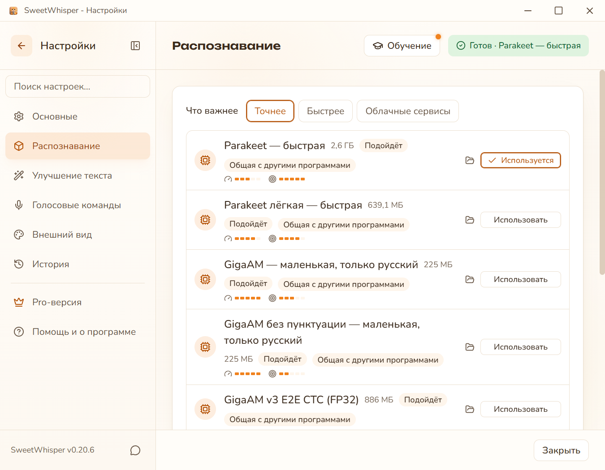
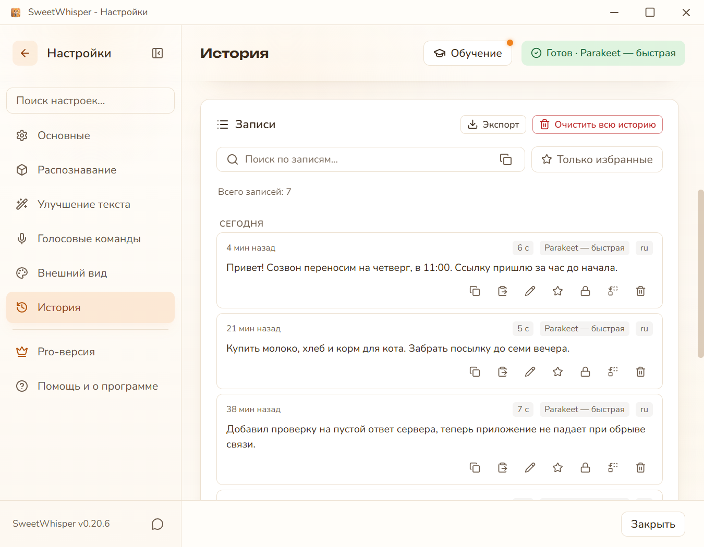
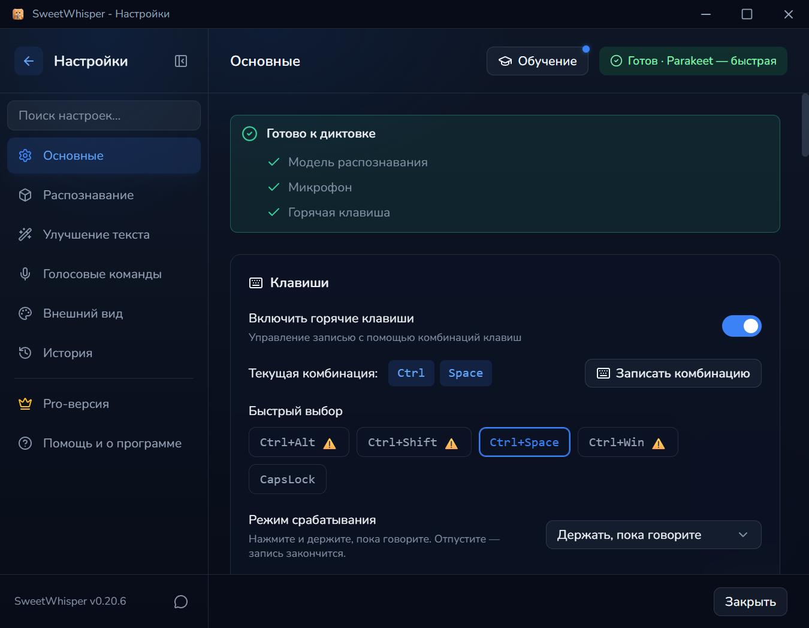
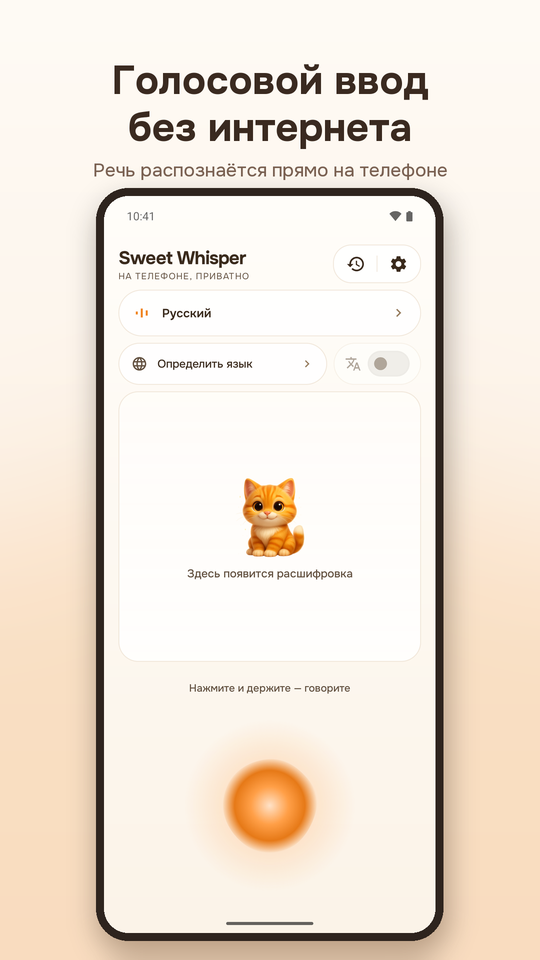
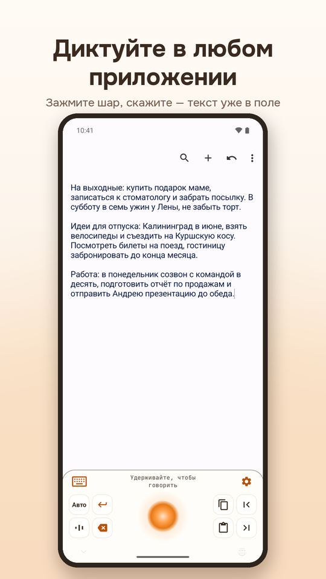
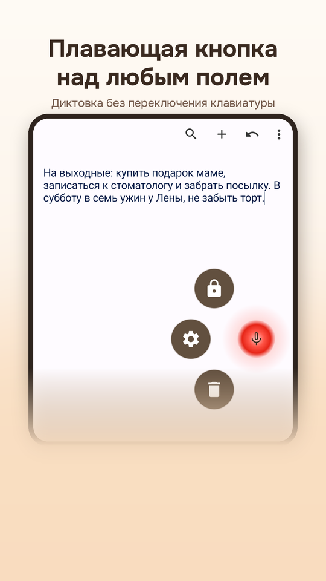
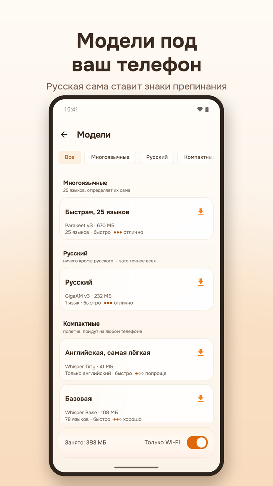

**Русский** · [English](README.en.md)

# SweetWhisper

### Говорите — текст появляется там, где стоит курсор

**Голосовой ввод для Windows и Android. Речь распознаётся прямо на вашем устройстве: без интернета, без подписки, голос никуда не уходит.**

<!-- Версии в бейджах правятся руками при каждом релизе. -->

[🌐 Сайт](https://sweetwhisper.app) · [📱 Android](https://sweetwhisper.app/android/) · [❓ Вопросы](#частые-вопросы) · [📝 Что нового](https://sweetwhisper.app/changelog/) · [🐛 Сообщить о баге](../../issues/new/choose)

---

## Как это работает

| 1. Зажмите клавишу | 2. Говорите | 3. Отпустите |
|:---:|:---:|:---:|
| Одна клавиша на всё. На телефоне — микрофон на клавиатуре | Модель слушает и распознаёт речь прямо на компьютере или телефоне | Готовый текст сам вставляется в активное окно: чат, почту, документ, редактор кода |

Без копирования, без переключения окон, без отправки голоса в облако.

## Почему SweetWhisper

- 🎯 **Хорошо понимает русский.** Модель GigaAM обучена именно на русской речи, а Whisper и Parakeet справляются со смешанной речью и английскими терминами. Всего — больше 90 языков.
- 🔒 **Голос остаётся у вас.** Распознавание идёт на вашей видеокарте или процессоре. Нет аккаунтов, нет телеметрии, работает даже в самолёте.
- ⌨️ **Работает в любой программе.** Telegram, браузер, Word, IDE — текст попадает туда, где мигает курсор.
- 💸 **Диктовка бесплатна навсегда.** Без лимитов по минутам и без подписки. Pro — разовая покупка для тех, кому нужно больше.
- 🐱 **Приятно пользоваться.** Аккуратная панель поверх окон, светлая, кремовая и тёмная темы, подсказки на каждом шаге.

## Windows

<table>
<tr>
<td width="50%"> <b>Сразу видно, что всё готово</b> — модель, микрофон и горячая клавиша</td>
<td width="50%"> <b>Модель под ваш компьютер</b> — точнее или быстрее, приложение подскажет</td>
</tr>
<tr>
<td width="50%"> <b>История с поиском</b> — всё, что вы надиктовали, хранится только у вас</td>
<td width="50%"> <b>Три темы</b> — светлая, кремовая и тёмная</td>
</tr>
</table>

- 🎙️ **Диктовка в любое окно** — зажмите клавишу или включите запись переключателем
- 🧠 **Три движка на выбор** — Whisper, Parakeet и GigaAM; ускорение на видеокартах NVIDIA, AMD и Intel
- 🗣️ **Голосовые команды** — «Котик, отмена», «Котик, открой блокнот»
- 📖 **Свой словарь** — имена и термины, которые модель должна писать правильно
- 📜 **История** — поиск по всему надиктованному, экспорт, избранное
- ✨ **В Pro:** текст появляется прямо во время речи, локальный ИИ убирает «эээ», расставляет знаки и переводит, расшифровка аудио и видео с субтитрами

## Android

Это голосовая клавиатура: вы диктуете там же, где обычно печатаете. Открыли чат, нажали микрофон, сказали — слова появляются прямо в сообщении.

- Диктовка с клавиатуры бесплатна и без лимитов — русский тоже
- Всё считается на телефоне: звук не сохраняется и никуда не уходит
- GigaAM сама ставит запятые и заглавные буквы
- Модель подбирается под ваш телефон при первом запуске
- Плавающая кнопка над любым полем, плитка в шторке, виджет
- Без рекламы, без аккаунта, без трекеров

[Как установить и включить клавиатуру — пошагово →](https://sweetwhisper.app/android/)

## Чем отличается от других

| | **SweetWhisper** | Облачные сервисы | Open-source утилиты | Диктовка Windows (Win+H) |
|---|:---:|:---:|:---:|:---:|
| Работает без интернета | ✅ | ❌ | ✅ | ❌ для русского |
| Звук остаётся на компьютере | ✅ | ❌ | ✅ | ❌ |
| Выбор модели распознавания | ✅ Whisper, Parakeet, GigaAM | ❌ своя | обычно только Whisper | ❌ |
| Голосовые команды | ✅ | ❌ | ❌ | ❌ |
| ИИ-доработка текста | ✅ Pro, локально | ✅ в облаке | ❌ | ❌ |
| Настраивать руками не нужно | ✅ | ✅ | ❌ | ✅ |
| Цена | бесплатно, Pro — разово | подписка | бесплатно | бесплатно |

## Скачать

| Платформа | Файл | Размер | С сайта | С GitHub |
|---|---|---|---|---|
| **Windows 10/11** · установщик | `SweetWhisper-Setup.exe` | 22,3 МБ | [скачать](https://sweetwhisper.app/dl/SweetWhisper-Setup.exe) | [v0.20.9](../../releases/tag/v0.20.9) |
| **Windows 10/11** · portable | `SweetWhisper-Portable.zip` | 42,7 МБ | [скачать](https://sweetwhisper.app/dl/SweetWhisper-Portable.zip) | [v0.20.9](../../releases/tag/v0.20.9) |
| **Android 9+** · APK | `SweetWhisper.apk` | 47,3 МБ | [скачать](https://sweetwhisper.app/dl/SweetWhisper.apk) | [android-v3.52](../../releases/tag/android-v3.52) |
| **Android 9+** · магазин | RuStore | — | [открыть в RuStore](https://www.rustore.ru/catalog/app/app.sweetwhisper.android) | — |

На сайте и в Releases лежит один и тот же файл, байт в байт. Ссылки на сайте всегда ведут на свежую сборку, а в [Releases](../../releases) остаются прошлые версии и контрольные суммы. Регистрация не нужна.

## Бесплатно и Pro

| | Бесплатно | Pro |
|---|:---:|:---:|
| Диктовка без лимитов, все модели, ускорение на видеокарте | ✅ | ✅ |
| История с поиском, голосовые команды | ✅ | ✅ |
| Свои голосовые команды на компьютере | до 5 | до 200 |
| Словарь замен на компьютере (на телефоне — без ограничений) | до 20 | без ограничений |
| Текст появляется прямо во время речи | — | ✅ |
| Локальный ИИ: чистка, пунктуация, режимы «письмо», «документ», «код» | — | ✅ |
| Перевод при диктовке | — | ✅ |
| Расшифровка аудио и видео, субтитры SRT/VTT, разделение говорящих | — | ✅ |
| Плавающая кнопка диктовки на Android | — | ✅ |

**Pro — разовая покупка, не подписка.** Один ключ открывает Pro и на компьютере, и на телефоне. Сначала можно попробовать бесплатно: на компьютере — 14 дней, на телефоне — первые 200 диктовок плавающей кнопкой. Карта и регистрация не нужны. [Сколько стоит и что входит →](https://sweetwhisper.app/buy/)

## Что нужно для работы

**Windows**
- Windows 10 или 11, 64-бит
- От 4 ГБ оперативной памяти — этого хватает для GigaAM, лёгкого Parakeet и Whisper Large V3 Turbo
- Видеокарта не обязательна. С ней быстрее и доступен живой предпросмотр: подойдёт NVIDIA, AMD или Intel со своей видеопамятью от 1 ГБ
- От 75 МБ до 3 ГБ на диске под модели — скачиваете только те, что выбрали

**Android**
- Android 9 или новее
- От 41 до 874 МБ под модель — приложение само предложит подходящую

## Частые вопросы

<b>Windows пишет «Неизвестный издатель». Это безопасно?</b>

Да. Это окно SmartScreen: Windows показывает его для файлов, которые пока мало кто скачивал. Репутация копится по числу установок, а у каждой новой версии начинается с нуля — это предупреждение о новизне, а не о вирусе. Нажмите «Подробнее» → «Выполнить в любом случае».

Не хотите верить на слово — сверьте контрольную сумму: в PowerShell выполните `Get-FileHash SweetWhisper-Setup.exe` и сравните SHA-256 с суммой на [странице релиза](../../releases/latest).

<b>Правда работает без интернета?</b>

Да. Интернет нужен один раз — скачать модель. Дальше распознавание идёт целиком на устройстве, хоть в самолёте. Облачные сервисы (OpenAI, Yandex SpeechKit) можно подключить своим ключом, но по умолчанию всё офлайн.

<b>Куда уходят мои записи?</b>

Никуда. Звук обрабатывается на вашем компьютере или телефоне, история хранится в локальной базе — её можно очистить в любой момент. Аккаунтов, рекламы и телеметрии нет. В сеть приложение выходит, чтобы скачать выбранную модель и проверить обновления; отчёт об ошибке отправляется, только если вы сами это включили. Полный список — в [политике приватности](https://sweetwhisper.app/privacy/).

<b>Pro отправляет текст в облако?</b>

Нет, если вы сами этого не включите. По умолчанию ИИ в Pro работает локально, текст не покидает компьютер — подходит и для конфиденциальных документов. Облачные модели подключаются только вручную, вашим ключом.

<b>Чем это лучше встроенной диктовки Windows или Google?</b>

Встроенная диктовка Windows отправляет голос в облако Microsoft, а для русского без интернета не работает. Голосовой ввод Google тоже обычно распознаёт на своих серверах. SweetWhisper распознаёт на устройстве, даёт выбрать модель, понимает голосовые команды и не показывает рекламу.

<b>Можно ли ставить APK не из магазина?</b>

Можно. Файл подписан нашим ключом: обновления ставятся поверх, подменить приложение чужой сборкой нельзя. Android один раз спросит, доверяете ли вы источнику, — это обычная процедура для приложений вне магазина. Проще всего поставить из [RuStore](https://www.rustore.ru/catalog/app/app.sweetwhisper.android): там обновления приходят сами. Берите APK только с sweetwhisper.app или отсюда, из Releases.

<b>А на Linux или macOS?</b>

Версия для Linux в разработке, основное уже работает. macOS пока не поддерживается.

Больше ответов — в [полном FAQ](https://sweetwhisper.app/faq/).

## Нашли ошибку? Есть идея?

Заведите [issue](../../issues/new/choose) — шаблон подскажет, что приложить. В приложении есть кнопка «Скопировать диагностику» (Настройки → «Помощь и о программе»): вставьте её вывод в сообщение, и починка пойдёт заметно быстрее. Правки выходят за дни, а не за месяцы.

Вопросы, впечатления и пожелания — в [обсуждения](../../discussions).

## Лицензия

SweetWhisper — проприетарное ПО (© Roger, все права защищены). В этом репозитории лежат материалы дистрибуции, а не исходный код.

Приложение построено на открытых движках — [whisper.cpp](https://github.com/ggml-org/whisper.cpp), [ONNX Runtime](https://github.com/microsoft/onnxruntime) — и открытых моделях: Whisper © OpenAI (MIT), GigaAM © SberDevices (MIT), Parakeet © NVIDIA (CC-BY-4.0), Silero VAD. Приложение для Android — форк [whisperIME](https://github.com/woheller69/whisperIME) © woheller69 (MIT). Полный список — в приложении: Настройки → О программе → «Open Source лицензии».
